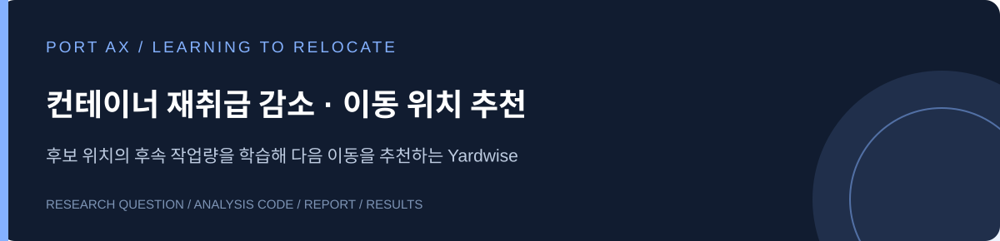

# 컨테이너 재취급 감소를 위한 AI 기반 이동 위치 추천

출고할 컨테이너 위에 다른 컨테이너가 있으면 먼저 옮겨야 합니다. 옮겨 놓은 컨테이너를 다시 이동하는 일을 줄이기 위해, 현재 적재 상태와 출고 확률로 이동 위치를 추천합니다.

**[웹 시뮬레이터](https://zzongzzz47.github.io/yardwise/) · [분석 보고서](reports/port_ax_report.pdf) · [학습·평가 코드](code/) · [실험 결과](results/)**

## 평가 결과

공개 연구자료의 평가용 224개 배치에서 컨테이너 4,132개를 모두 출고한 결과입니다.

| 방법 | 재취급 횟수 |
|---|---:|
| 높이 우선 규칙 | 2,362 |
| 출고 우선순위 규칙 | 2,118 |
| 확률 위험 규칙 | 2,095 |
| 학습한 AI | **1,919** |
| 가상 미래 탐색 | 1,889 |

AI는 출고 우선순위 규칙 대비 **199회(9.4%)**의 재취급을 줄였습니다. 출고 확률을 활용하는 규칙과 탐색에도 같은 확률을 제공했습니다. AI가 미래 탐색보다 재취급을 더 줄인 결과는 아닙니다.

## 모형의 역할

여러 가상 출고 순서에서 후보별 재취급 비용을 계산해 학습자료를 만듭니다. Extra Trees 회귀모형은 현재 적재 상태와 출고 확률에서 계산한 40개 입력으로 후보의 상대 비용을 예측합니다. 추천할 때는 저장된 모형을 사용합니다.

- 학습 336개 / 검증 112개 / 평가 224개 초기 배치
- 네 가지 독립 진행 방식에서 모든 이동 판단과 가능한 목적지를 수집
- 학습 라벨: 판단마다 공통된 가상 미래 12개, 비교용 미래 탐색: 24개
- Extra Trees: 회귀나무 100개, 최대 깊이 16

출고 확률 자체를 새로 예측한 모형은 아닙니다. 연구자료의 확률을 입력으로 활용한 계산 실험이며 국내 항만의 현장 성과와 구분합니다. 이번 결과는 이전에도 검토한 평가 집합의 재평가입니다. [실험 구성과 재현 안내](code/README.md)

## 코드와 보고서

| 위치 | 내용 |
|---|---|
| `code/` | 사용한 학습·평가 스크립트와 데이터 수집 코드 |
| `reports/` | 공모전 분석보고서 PDF |
| `results/` | 최신 실험의 집계, 설계 및 검증 기록 |
| 루트의 `index.html`, `app.js`, `engine.js` | 기존 웹 프로토타입 |
| `assets/` | 웹 시연 데이터와 추론용 모형 |

웹사이트는 로그인과 설치 없이 이용할 수 있습니다. 로컬에서는 저장소 루트에서 `python -m http.server 8787`을 실행한 뒤 브라우저로 접속합니다.

## 데이터 출처

Zhang, Zhanluo (2024). *Probabilistic Container Relocation Problem*, Version 3. [Mendeley Data](https://doi.org/10.17632/3j52cjrm52.3), [CC BY 4.0](https://creativecommons.org/licenses/by/4.0/).

원자료에 확률 정규화, 학습자료 생성, 독립 모형 학습과 브라우저 추론 형식 변환을 적용했습니다. 연구자료와 모형·프로토타입의 역할은 구분합니다.
